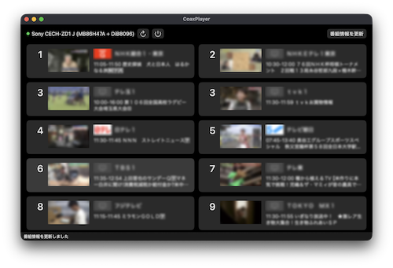

# CoaxPlayer

[coax](https://github.com/Till0196/coax)（Till0196 さん作）で受信した地上デジタル放送を見るための、macOS 用のプレーヤーです。



- チャンネルスキャンと、局ロゴ・今の番組・映像のプレビューが並ぶ一覧からの選局
- ワンセグ・フルセグの再生、ARIB 字幕、二か国語（主・副音声）の切り替え
- 録画（TS）

## 動作環境

- Apple Silicon の Mac、macOS 13 以降
- coax が対応する USB 接続の ISDB-T チューナー（動作確認は Sony CECH-ZD1 J）、または pix-userland を通した PIX-DT295

## インストール

[Homebrew](https://brew.sh/) でインストールできます。`/Applications/CoaxPlayer.app` に入ります。

```sh
brew install --cask bellx2/tap/coaxplayer
```

更新と削除は次のとおりです。

```sh
brew upgrade --cask coaxplayer
brew uninstall --cask coaxplayer          # アプリだけ消す
brew uninstall --cask --zap coaxplayer    # スキャン結果と設定も消す（録画は残る）
```

新しい版が出ると、メニューバーの「CoaxPlayer」に「新しい版 <版> に更新…」が出ます。押すと Homebrew で更新して起動し直します。

Homebrew を使わないときは、[Releases](https://github.com/bellx2/CoaxPlayer/releases) から `CoaxPlayer_<版>_macos-arm64.zip` をダウンロードして展開し、`CoaxPlayer.app` を「アプリケーション」フォルダーに入れます。

どちらも Developer ID で署名し、Apple の公証を受けているので、そのまま開けます。coax と再生に使うライブラリは `.app` に入っているので、ほかに入れるものはありません。

## 使い方

1. `CoaxPlayer.app` を起動し、設定画面（⌘,）の「チャンネルスキャン」でスキャンします
2. 一覧のチャンネルを押すと再生します。Esc か delete で一覧に戻ります

数字キーでも、リモコンの番号で選局できます。詳しくは [docs/usage.md](docs/usage.md)。

フルセグを見るには、利用者が用意した外部のデコーダーを設定画面で指定します（[docs/decoder.md](docs/decoder.md)）。デコーダーはこのアプリには含まれません。

ピクセラの PIX-DT295 も使えます。設定画面の「チューナー」で選び、ファームウェア（[pix-userland](https://github.com/Khronos31/pix-userland) の `firmware/dt295.bin`）を指定します（[docs/dt295.md](docs/dt295.md)）。ファームウェアはこのアプリには含まれません。

## 既知の制限

- 衛星放送（ISDB-S）には対応していません
- ファイルの再生では字幕を出しません

## ドキュメント

- [docs/usage.md](docs/usage.md): 画面の操作、起動引数
- [docs/decoder.md](docs/decoder.md): 外部デコーダーのつなぎ方
- [docs/dt295.md](docs/dt295.md): PIX-DT295 を pix-userland で使う
- [docs/build.md](docs/build.md): ソースからのビルド
- [docs/architecture.md](docs/architecture.md): 内部の構成

## ライセンス

このリポジトリのコードは MIT ライセンスです（[LICENSE](LICENSE)）。
`.app` に同梱する coax・FFmpeg・mpv などはそれぞれの条件に従います。一覧は [NOTICE](NOTICE)、ライセンスの全文は `.app` の `Contents/Resources/licenses/` にあります。

同梱する coax と coaxd は上流の [Till0196/coax](https://github.com/Till0196/coax) に CoaxPlayer のための変更を足した改変版です（coaxd は GPL-2.0-only）。ソースは [bellx2/coax](https://github.com/bellx2/coax) の `coaxplayer-v<版>` のタグにあります。